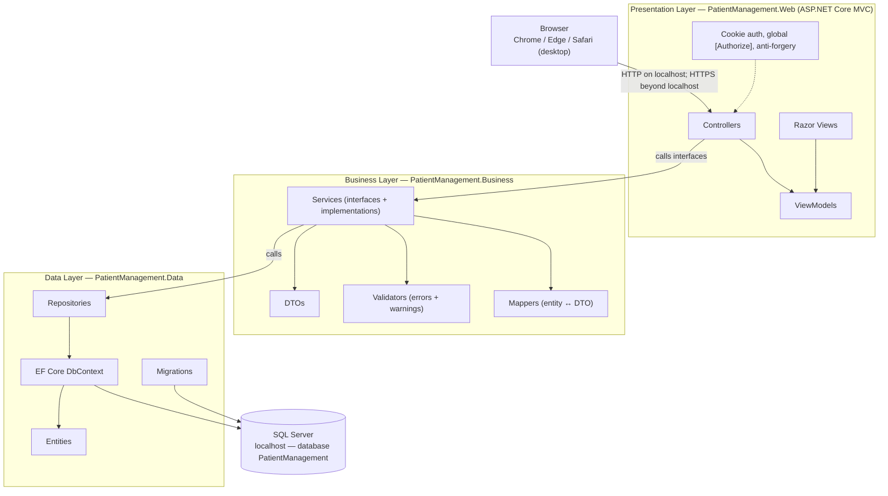
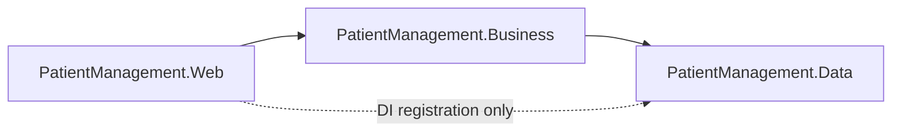
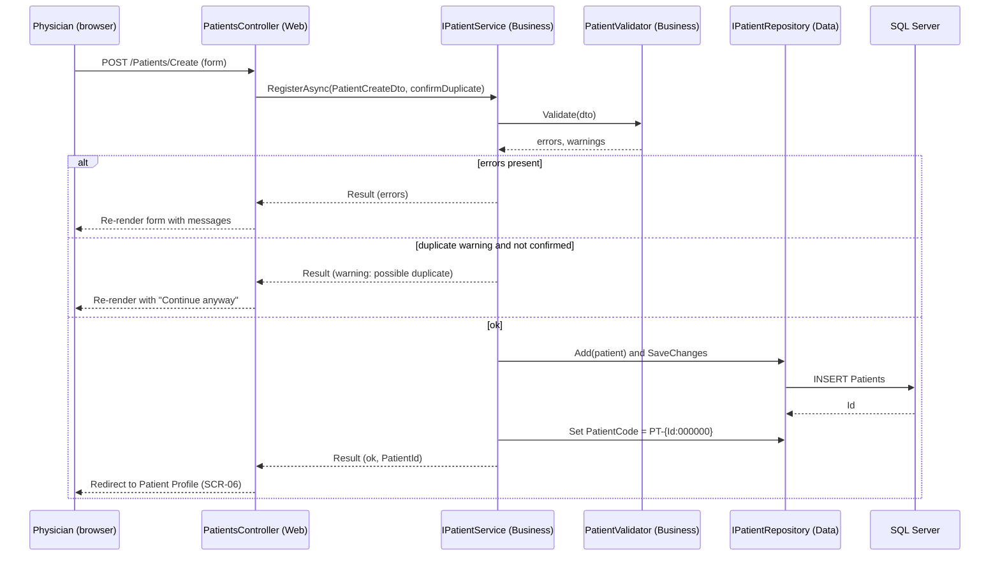

# 02 — Three-Tier Architecture Diagram

**Source:** `01-Solution-Architecture.md` (AD-01, AD-02, AD-03)
**Status:** Proposed for review

## 1. Logical View

## 2. Dependency Rules

| Rule | Allowed | Forbidden |
|---|---|---|
| Web → Business | Service interfaces, DTOs | Calling repositories or DbContext directly |
| Business → Data | Repository calls, entities inside Business internals | Returning entities to Web |
| Data → Business or Web | — | Any reference upward |
| Web → Data | Startup registration only (`AddPmsData`) | Querying data from controllers |

## 3. Request Flow (example: register a patient, FR-PAT-001)

## 4. Layer-to-Screen Mapping

| Screen group | Presentation | Business | Data |
|---|---|---|---|
| Login, forgot password (SCR-01, SCR-02) | AccountController, ViewModels | IAuthService | Users table |
| Home, search, patient screens (SCR-03 to SCR-07) | Patients, Home controllers | IPatientService, IVisitService | Patients, Consultations |
| Appointments (SCR-09, SCR-10) | AppointmentsController | IAppointmentService | Appointments |
| Consultation and prescription (SCR-11, SCR-12) | ConsultationsController, PrescriptionsController | IConsultationService, IPrescriptionService | Consultations, VitalSigns, Prescriptions, PrescriptionItems |
| Export (SCR-13) | ExportController | IExportService | Patients, Consultations, VitalSigns, PrescriptionItems |
| Clinic profile (SCR-14, PDR-15) | ClinicProfileController | IClinicProfileService | ClinicProfile |
