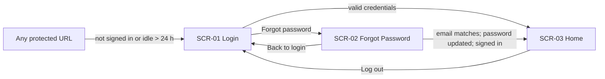
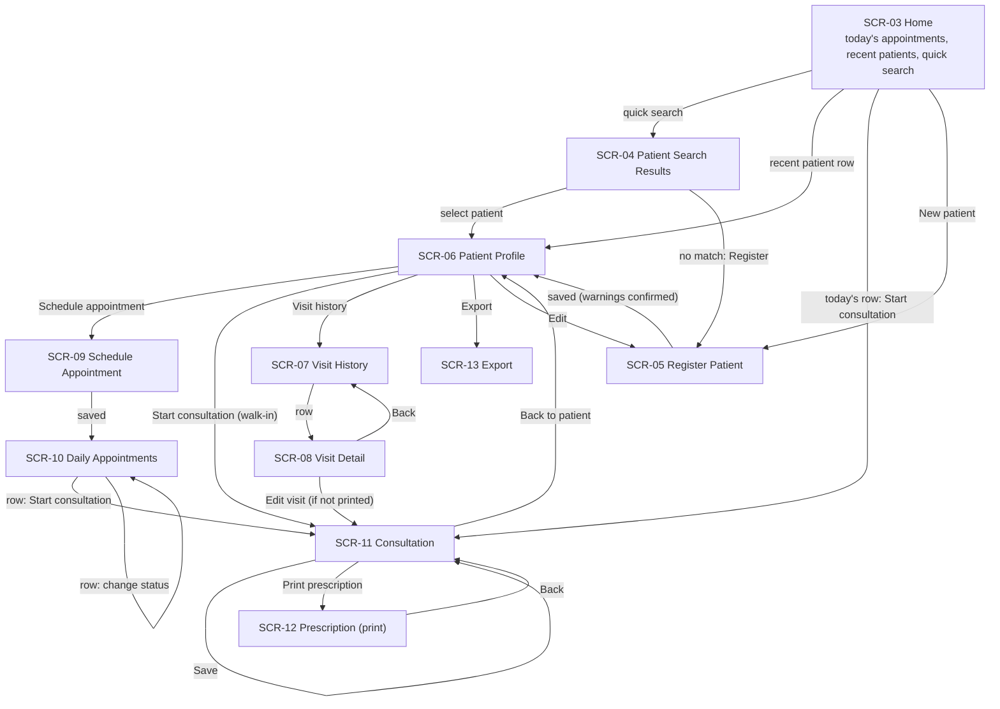

# 04 — Navigation Flow

**Source:** BRD: Scope; Patient Management; Appointment Management; Consultation Workflow; Patient History; Search & Navigation; Data Export; Security
**Status:** Proposed for review. Screen IDs are defined in `05-Screen-Catalog.md`.

## 1. Global Navigation

Every page after login shows the same top bar:

| Item | Destination | Req IDs |
|---|---|---|
| Home | SCR-03 | FR-APT-002, FR-SRC-001, FR-SRC-002 |
| Patients | SCR-04 (search) | FR-PAT-004, FR-SRC-001 |
| Appointments | SCR-10 (today) | FR-APT-002 |
| Clinic Profile | SCR-14 (PDR-15) | FR-RX-002 |
| Log out | Login (SCR-01) | NFR-SEC-001 |

A quick search box sits on the top bar. It submits to SCR-04 (FR-SRC-001).

## 2. Authentication Flow

- Protected: every page except SCR-01 and SCR-02.
- An expired session returns to SCR-01. The BRD gives no notice text for expiry; PDR-03 covers only the password reset message.

## 3. Main Clinical Flow

### Notes
- **Walk-in (FR-VIT-001, BRD: Consultation):** the patient is registered on arrival (SCR-05) and a consultation starts from SCR-06 with no appointment.
- **Recent patients (FR-SRC-002):** shown on SCR-03; the five most recently visited patients.
- **Visit detail edit:** allowed only while the prescription is not printed. Vitals, complaints and diagnosis can be updated later (FR-VIT-001). Printed prescriptions stay read-only (FR-RX-002).

## 4. Navigation Rules

| Rule | Detail | Req IDs |
|---|---|---|
| Every visit is reachable from its patient profile | SCR-06 → SCR-07 → SCR-08 | FR-SRC-003, FR-HIS-001 |
| Every visit's content is reachable from its visit | SCR-08 shows vitals, complaints, diagnosis and prescription | FR-HIS-002 |
| Date filter applies to the visit list only | SCR-07 filter: single date or range | FR-HIS-003 |
| Export is started from a patient | SCR-06 → SCR-13 (single patient) | FR-EXP-001, FR-EXP-002 |
| Appointments are never deleted | Status change or archive only | FR-APT-003 |
| Back navigation keeps the context | Return to the same patient, date or list | NFR-USB-001 |

## 5. Breadcrumbs and Back Links

Patient pages show `Patients › {Patient name} › {Section}`. Visit pages show `Patients › {Patient name} › Visits › {Date}`. Breadcrumbs are navigation only and do not add features.
