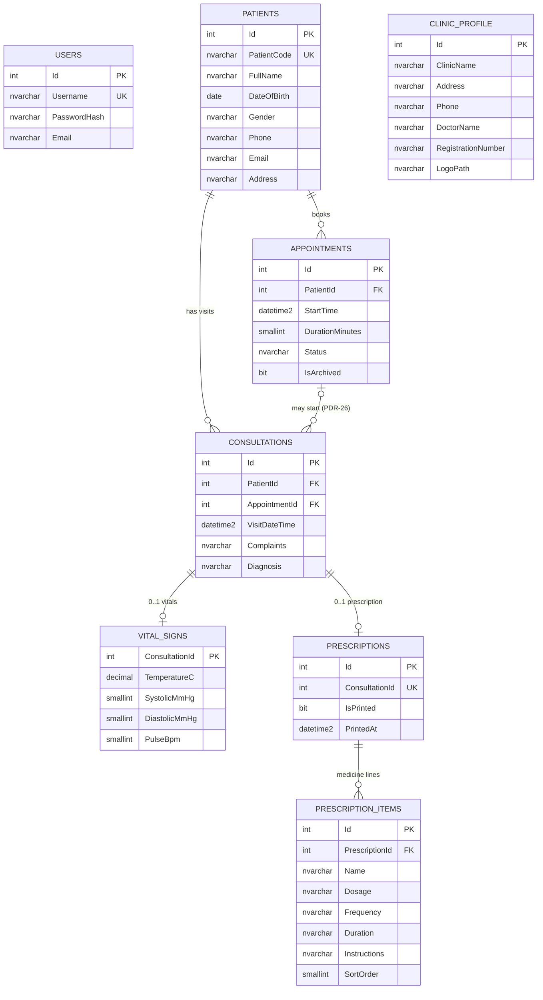
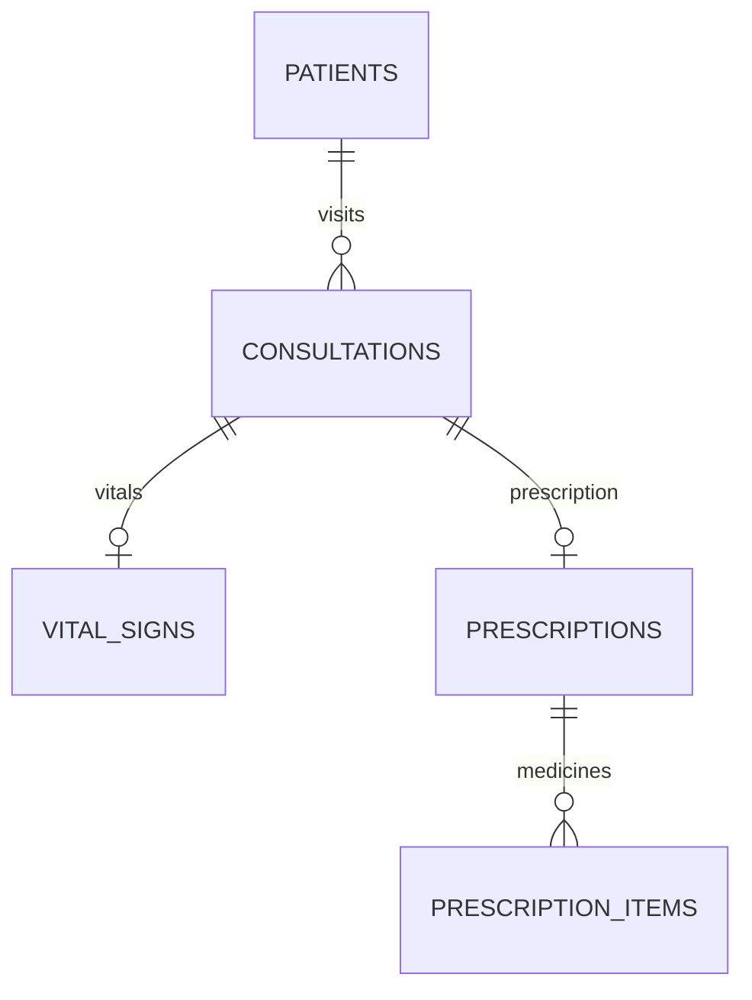

# 08 — Entity Relationship Diagram

**Source:** `06-Entity-Design.md`, `07-Database-Design.md`
**Status:** Proposed for review. Diagram notation: Mermaid `erDiagram`.

## 1. Full ERD

`USERS` and `CLINIC_PROFILE` have no relationship to the clinical tables. `USERS` is the single login account. `CLINIC_PROFILE` is a single-row header source for the print view.

## 2. Clinical Core (simplified)

## 3. Requirement Coverage per Table

| Table | Requirements that depend on it |
|---|---|
| USERS | NFR-SEC-001 |
| PATIENTS | FR-PAT-001 to FR-PAT-004, FR-SRC-001, FR-SRC-002, FR-EXP-001, FR-EXP-002 |
| APPOINTMENTS | FR-APT-001 to FR-APT-003 |
| CONSULTATIONS | FR-CMP-001, FR-DIA-001, FR-HIS-001 to FR-HIS-003, FR-SRC-002, FR-SRC-003 |
| VITAL_SIGNS | FR-VIT-001, FR-RX-002, FR-HIS-002, FR-EXP-001, FR-EXP-002 |
| PRESCRIPTIONS | FR-RX-002, SC-004 |
| PRESCRIPTION_ITEMS | FR-RX-001, FR-RX-002, FR-HIS-002 |
| CLINIC_PROFILE | FR-RX-002 |
