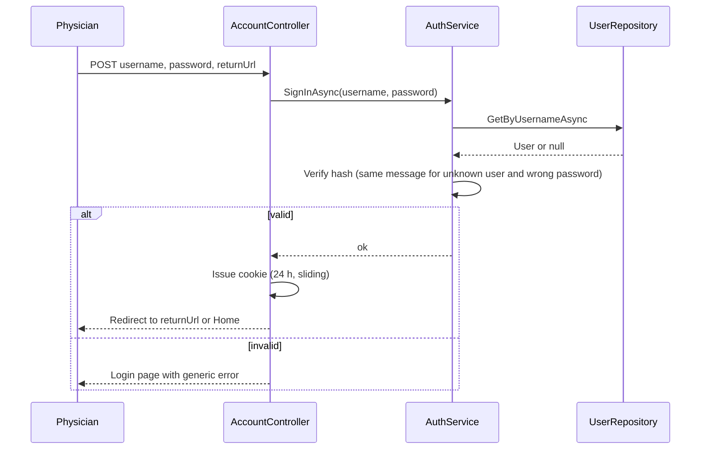
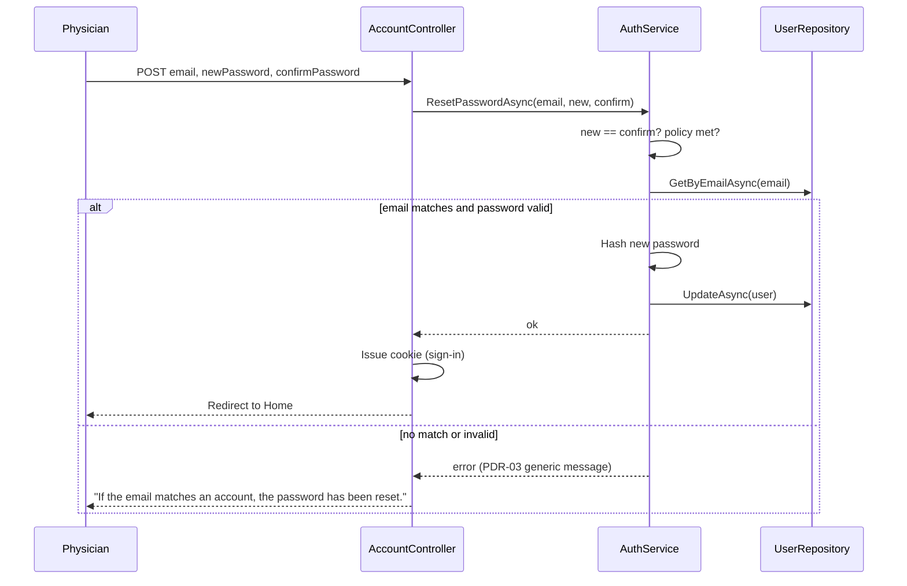

# 12 — Authentication Design

**Source:** BRD: Non-Functional Requirements > Security
**Req IDs:** NFR-SEC-001 (secure single-user login), NFR-SEC-002 (password hashing; data in transit beyond localhost; encryption at rest out of Phase 1, DEC-017)
**Status:** Proposed for review. Password policy (PDR-02) and idle timeout (PDR-20) decided 2026-11-10. Seeding amended by DEC-018 (§8).

## 1. BRD Requirements Being Designed

| BRD statement | Design response |
|---|---|
| Single user authentication: username and password only | One account. Username and password form. No email login, no social login, no second factor |
| Minimum 8 characters with complexity | Password policy: length ≥ 8 plus a complexity rule (PDR-02) |
| 24-hour idle timeout | Cookie authentication with 24-hour expiry and sliding renewal on activity |
| Forgot password: email, new password, confirm; if email matches, update and log in; no second verification | Forgot-password form (SCR-02). Email match, then password update, then sign-in. No token, no email sent |
| Passwords stored using secure hashing, never plain text | Salted, one-way hash (ASP.NET Core `PasswordHasher`) stored in `Users.PasswordHash` |
| Risk accepted by stakeholder | Recorded as DEC-009 and RSK-003. Not re-opened in this design |

## 2. Components

| Component | Role |
|---|---|
| AccountController | Login, logout and forgot-password actions (§3 below) |
| IAuthService / AuthService (Business) | Credential check, password reset, password policy |
| IUserRepository (Data) | Find user by username or email; save hash |
| Cookie authentication middleware (Web) | Issues and validates the sign-in cookie |
| IPasswordHasher (Business interface) | Hash and verify a password. No ASP.NET types in Business (approved 2026-11-10) |
| Password hasher adapter (Web) | Implements `IPasswordHasher` over the ASP.NET Core `PasswordHasher`: salted one-way hash, PBKDF2-based (PDR-04: hasher only, custom Users table) |

## 3. Flows

### 3.1 Login (SCR-01)

- Error text is the same for unknown username and wrong password.
- No lockout counter. The BRD does not define one, so none is designed (see §6).

### 3.2 Forgot Password (SCR-02)

- No email is sent. No code is generated. This follows the BRD exactly.
- Stakeholder accepted that anyone who knows the registered email can reset the password (DEC-009, RSK-003).

### 3.3 Logout
- POST to `/Account/Logout`. Cookie removed. Redirect to SCR-01.

### 3.4 Session Expiry
- Cookie expires 24 hours after the last request (sliding). After expiry, any protected URL redirects to SCR-01 with the original URL as `returnUrl`.

## 4. Configuration

| Setting | Value | Source |
|---|---|---|
| Cookie name | `PatientManagement.Auth` | Design |
| ExpireTimeSpan | 24 hours | NFR-SEC-001 |
| SlidingExpiration | true | Sliding, as decided under PDR-20 |
| HttpOnly | true | Design |
| SecurePolicy | Always when HTTPS; not required on localhost HTTP | NFR-SEC-002, PDR-21 |
| SameSite | Lax | Design |
| Login path | `/Account/Login` | Design |
| Default policy | Require authenticated user for all controllers, except `[AllowAnonymous]` on login and forgot-password | NFR-SEC-001 |

## 5. Password Policy

| Rule | Value | Status |
|---|---|---|
| Minimum length | 8 characters | BRD (OQ-015) |
| Complexity | Must include upper case, lower case, digit and symbol | PDR-02, decided 2026-11-10 |
| Hash | Salted one-way hash | BRD (secure hashing) |
| Storage | Hash only; plain text never stored or logged | BRD |
| Reuse | Not stated. Not designed | PDR-02 (no rule given) |
| Maximum length | 16 characters | PDR-02, decided 2026-11-10 |

## 6. Known Limits (recorded, not designed around)

| Limit | Source | Note |
|---|---|---|
| No lockout after failed logins | BRD silent | Not designed. Risk not in RTM. Would need a BRD amendment if wanted |
| No second verification on password reset | BRD, DEC-009 | Accepted risk (RSK-003) |
| Forgot-password response reveals whether an email exists | Design consequence | Message per PDR-03 |
| No change-password screen | BRD silent | Not designed. Use forgot-password flow |
| Single account only | BRD, CON-002 | Account created by the console seed command (PDR-05, DEC-018) |

## 7. Requirement Trace

| Element | Req ID |
|---|---|
| Login required for every page except login and forgot password | NFR-SEC-001 |
| Single user account | NFR-SEC-001, CON-002 |
| 24-hour idle timeout | NFR-SEC-001 |
| Forgot password flow | NFR-SEC-001 |
| Hashed passwords | NFR-SEC-001 |
| HTTPS beyond localhost | NFR-SEC-002 |
| Anti-forgery tokens on POST | NFR-SEC-001 (supports login and form integrity) |

## 8. Account Seeding (PDR-05 as amended, DEC-018)

- A console command creates the single account when none exists. It is run once per machine (`dotnet run --project src/PatientManagement.Web -- seed-user`, planned command name).
- The command prompts for username, email and password. The password is entered twice and is not shown on screen.
- The password must meet the policy in §5. The command stores only the hash.
- Nothing is stored in source, configuration, user secrets or the repository. The password is never logged.
- If an account already exists, the command stops and changes nothing.
- The command does not run at application start.
- There is no sign-in fallback to the single account. Sign-in always matches the username.
