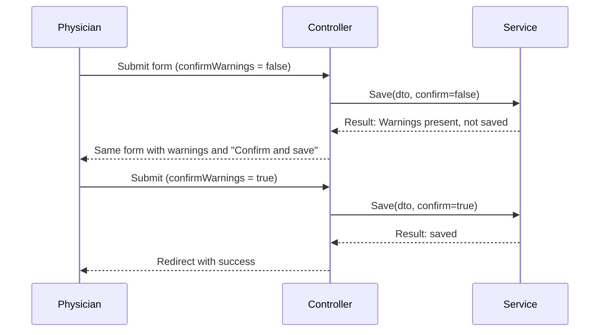

# 13 — Validation Strategy

**Source:** BRD: Patient Management, Appointment Management, Consultation Workflow (Vitals), Medication / Prescription
**Rule:** The BRD defines which values are required and which ranges warn. It does not define formats. Format rules are listed as PDR items, not as assumed rules.
**Status:** Proposed for review

## 1. Validation Layers

| Layer | What it checks | Blocking? | Example |
|---|---|---|---|
| Browser (client) | Required fields, numeric type, date picker format | Yes (prevents submit) | Name empty |
| Presentation | Model binding, anti-forgery | Yes | Missing token |
| Business (validators) | All BRD rules. Returns errors and warnings | Errors block; warnings need confirmation | Vitals out of range |
| Data (database) | NOT NULL, UNIQUE, FK, length, enumerated CHECK | Yes | Duplicate PatientCode |

The business validator is authoritative. The browser check is a convenience and never the only check.

## 2. Rule Types

| Type | Meaning | Save allowed? | Example |
|---|---|---|---|
| Error | Breaks a required rule or structural rule | No | Phone empty |
| Warning | Likely data entry issue; physician must confirm | Yes, after confirmation | Temperature 43.0 °C |
| Notice | Information only | Yes | Missing vitals (BRD: warn and do not block) |

Notices and warnings display in the same panel. Only warnings have a confirm control. (Missing vitals is a notice; no confirm click, per PDR-19.)

## 3. Rules by Requirement

### 3.1 Patient (FR-PAT-001, FR-PAT-002)

| Field | Rule | Type | Source | Req IDs |
|---|---|---|---|---|
| FullName | Required | Error | BRD | FR-PAT-001 |
| DateOfBirth | Required | Error | BRD | FR-PAT-001 |
| DateOfBirth | Valid date, not in the future | Error | PDR-22 (decided) | FR-PAT-001 |
| Gender | Required; value from list | Error | BRD (required); Male, Female, Other (PDR-01) | FR-PAT-001 |
| Phone | Required | Error | BRD | FR-PAT-001 |
| Phone | Format (digits, allowed symbols) | Error | PDR-22 | FR-PAT-001 |
| Email | Required | Error | BRD | FR-PAT-001 |
| Email | Valid email format | Error | PDR-22 | FR-PAT-001 |
| Address | Required | Error | BRD | FR-PAT-001 |
| Duplicate | Same FullName, DateOfBirth or Phone as another patient | Warning (confirm to continue) | BRD: "show a warning and let the doctor continue"; exact match (PDR-10) | FR-PAT-001 |
| Age | Calculated from DateOfBirth and system date; not editable | — | BRD | FR-PAT-001 |

### 3.2 Search (FR-PAT-004, FR-SRC-001)

| Rule | Type | Source |
|---|---|---|
| Search term empty | Error | Design (PDR-23) |
| Minimum term length | None (PDR-23) |

### 3.3 Appointment (FR-APT-001, FR-APT-003)

| Rule | Type | Source | Req IDs |
|---|---|---|---|
| Patient selected and registered | Error | BRD: registration first | FR-APT-001 |
| Duration 30 minutes | Structural (fixed) | BRD | FR-APT-001 |
| StartTime on the slot grid | Error | PDR-06 | FR-APT-001 |
| No overlap with a non-archived appointment at the same slot | Error | BRD: appointments cannot overlap; PDR-07 | FR-APT-001 |
| Status is one of the six lifecycle values | Error | BRD; `19-` | FR-APT-003 |
| Status change follows the transition table | Error | PDR-08; `19-` | FR-APT-003 |

### 3.4 Consultation and Vitals (FR-VIT-001, FR-CMP-001, FR-DIA-001)

| Rule | Type | Source | Req IDs |
|---|---|---|---|
| Patient exists | Error | BRD | FR-HIS-001 |
| Temperature numeric, unit °C | Error if not number | BRD units | FR-VIT-001 |
| Temperature 34.0–42.0 °C | Warning outside range | BRD | FR-VIT-001 |
| Systolic 70–250 mmHg | Warning outside range | BRD | FR-VIT-001 |
| Diastolic 40–150 mmHg | Warning outside range | BRD | FR-VIT-001 |
| Pulse 30–220 bpm | Warning outside range | BRD | FR-VIT-001 |
| Any vital missing | Notice (warning shown, save allowed) | BRD | FR-VIT-001 |
| Systolic and diastolic both entered or both empty | Error if only one | Design | FR-VIT-001 |
| Complaints and diagnosis | Free text; no length rule in BRD. DB max only | BRD (free text) | FR-CMP-001, FR-DIA-001 |
| Save while prescription printed | Error ("printed prescriptions cannot be changed") | BRD | FR-RX-002 |

Consultation can be saved with missing vitals. Vitals can be added later (BRD).

### 3.5 Medicine and Prescription (FR-RX-001, FR-RX-002)

| Rule | Type | Source | Req IDs |
|---|---|---|---|
| Medicine Name required | Error | Design (name needed to print); PDR-13 | FR-RX-001 |
| Dosage, Frequency, Duration, Instructions | Optional (PDR-13) | BRD lists them, does not mark them required | FR-RX-001 |
| Prescription with no medicine line | Error: cannot print (PDR-13) | PDR-13 | FR-RX-002 |
| Second prescription for the same consultation | Error (returns existing) | BRD: one per consultation | FR-RX-002 |
| Edit after print | Error | BRD | FR-RX-002 |
| Print without clinic header data | Notice on print view | PDR-15 | FR-RX-002 |

### 3.6 Export (FR-EXP-001, FR-EXP-002)

| Rule | Type | Source |
|---|---|---|
| Patient selected | Error | BRD: single patient |
| From date after To date | Error | Design |
| Range optional | — | BRD |

### 3.7 Login and Password (NFR-SEC-001)

| Rule | Type | Source |
|---|---|---|
| Username and password required | Error | BRD |
| Password length ≥ 8 | Error | BRD |
| Password complexity | Error (8 to 16 characters; upper case, lower case, digit, symbol) | PDR-02 |
| Confirm password equals new password | Error | BRD (confirm password) |
| Email matches a user | Error (PDR-03 message) | BRD |

## 4. Warning Flow (AD-11)

- The confirm flag is a hidden field set only by the "Confirm and save" button.
- Changing any field clears the confirm state (the form is re-validated).
- Errors always win. If errors and warnings both exist, the user sees errors first and no save happens.

## 5. Messages

| Type | Style | Example text (proposed wording) |
|---|---|---|
| Error | Red, next to field and in summary | "Phone is required." |
| Warning | Amber, summary panel | "Temperature 43.0 °C is outside the expected range 34.0–42.0 °C. Confirm to save." |
| Notice | Blue, summary panel | "No vitals recorded. You can add them later." |
| Printed block | Grey banner | "This prescription was printed and can no longer be changed." |

Wording is a proposal. Final text is subject to review.

## 6. Validation Test Mapping

Each rule above maps to at least one test case in `14-Testing-Strategy.md` §4. Ranges (boundary values 33.9, 34.0, 42.0, 42.1, etc.) are tested at both sides of each boundary.
