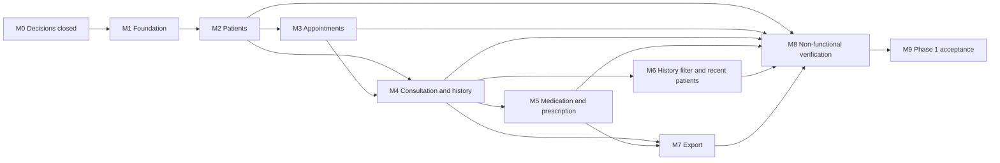

# 15 — Development Roadmap

**Source:** `16-Work-Breakdown-Structure.md`, `18-Planning-Traceability-Matrix.md`
**Scope:** Phase 1 only (BRD). Sequence only. No dates or effort estimates are set here.
**Status:** Proposed for review

## 1. Principles

- All work is committed directly to `development`, the only working branch, under the approved workflow (CLAUDE.md §5.4, 2026-11-10). Commits are made regularly and reported in chat.
- A feature starts only when its PDR items are closed. All were closed on 2026-11-10.
- Each milestone ends with its requirements tested (`14-Testing-Strategy.md`).
- Non-functional verification runs on a release candidate, after all features are merged.

## 1A. Implementation Priority (approved 2026-11-10)

Implementation follows this order. Each item maps to the milestone in §2.

| Order | Item | Milestone |
|---|---|---|
| 1 | Authentication (login, password rules, idle timeout, forgot password) | M1 (login part) |
| 2 | Patient Management | M2 |
| 3 | Appointments | M3 |
| 4 | Consultations (vitals, complaints, diagnosis, visit history) | M4 |
| 5 | Prescriptions | M5 |

After item 5: M6 (history filter, recent patients), M7 (export), M8 (non-functional verification), M9 (acceptance). A polished home page can be completed later.

## 2. Milestones

| Milestone | Name | Requirements | Depends on | Exit gate |
|---|---|---|---|---|
| M0 | Decisions closed | All PDR items in `17-Planning-Decisions-and-Open-Items.md` with Blocking = Yes | — | Done 2026-11-10: decisions recorded and BRD amended |
| M1 | Foundation | NFR-SEC-001 (shell), NFR-USB-001 (layout), NFR-CMP-001 (browser setup) | M0 | Solution builds; migrations apply; login works with seeded user; layout renders |
| M2 | Patients | FR-PAT-001 to FR-PAT-004, FR-SRC-001 | M1 | Register, edit, view, search pass TC; duplicate warning works |
| M3 | Appointments | FR-APT-001 to FR-APT-003; Home page daily list (FR-APT-002) | M2 | Schedule, overlap rejected, daily list, status change pass TC |
| M4 | Consultation and history | FR-VIT-001, FR-CMP-001, FR-DIA-001, FR-HIS-001, FR-HIS-002, FR-SRC-003 | M2, M3 | Consultation saves with warnings; visit history and detail pass TC |
| M5 | Medication and prescription | FR-RX-001, FR-RX-002, SC-004; clinic header data (PDR-15) | M4 | Medicines saved; print view complete; edit after print blocked |
| M6 | History filter and recent patients | FR-HIS-003, FR-SRC-002 | M4 | Date filter and recent list pass TC |
| M7 | Export | FR-EXP-001, FR-EXP-002, SC-005 | M4, M5 (prescription data) | CSV opens; printable export view prints and saves to PDF; content and range correct |
| M8 | Non-functional verification | NFR-PRF-001, NFR-PRF-002, SC-001, SC-002, NFR-CMP-001, NFR-SEC-002, NFR-SCL-001 | M2 to M7 | Measurements recorded; browser matrix run; encryption checks done |
| M9 | Phase 1 acceptance | All in-scope IDs (31) | M8 | Acceptance script complete; Project Owner acceptance |

Notes:
- M3 and M4 depend on M2 because appointments and consultations need a patient.
- M6 is kept separate so it can be built after the core visit flow without blocking M5.
- SC-003, SC-006, NFR-REL-001 and NFR-REL-002 are not on the roadmap (OOS-011, OOS-014).

## 3. Sequence Diagram

## 4. Commit Plan on `development` (per milestone)

| Milestone | Commits on `development` | Commit approach |
|---|---|---|
| M0 | Planning decisions and BRD amendments (docs) | Regular commits and pushes |
| M1 | Foundation work packages (WP-2.x), one commit per step | Regular commits and pushes |
| M2 | Patient management (WP-3.x) | Regular commits and pushes |
| M3 | Appointments (WP-4.x) | Regular commits and pushes |
| M4 | Consultation and history (WP-5.x) | Regular commits and pushes |
| M5 | Medication and prescription (WP-6.x) | Regular commits and pushes |
| M6 | History filter and recent patients (WP-7.x) | Regular commits and pushes |
| M7 | Export (WP-8.x) | Regular commits and pushes |
| M8 | Non-functional verification results (WP-9.x) | Regular commits and pushes |
| M9 | Acceptance record (WP-10.x) | Regular commits and pushes |

No branch is created for a milestone. Each milestone ends with its checks passing on `development`. A release PR to `main` is raised only when the Project Owner decides a release is due (`Documentation/03-Worktree/05-Release-Process.md`).

## 5. Risks to the Roadmap

| Risk | Affects | Mitigation | Register ref |
|---|---|---|---|
| Decisions reopened after M0 | All | Changes go through a BRD amendment first (CON-017) | 17-Planning-Decisions |
| Search performance fails NFR-PRF-002 | M2, M8 | Measure early in M2 with seed data; add index if needed | 07-Database-Design §4 |
| Printing layout differs by browser | M5, M8 | Build print CSS in M5; browser matrix in M8 | NFR-CMP-001 |
| Browser print or Save as PDF output differs by browser | M5, M7, M8 | Check the print view in each supported browser in M8 | NFR-CMP-001 |
| Single developer context switching | All | One milestone at a time | — |
| Stale Module 1 artifacts | M0 | Refresh listed items before M1 (see review package) | 00-Planning-Review-Package |
