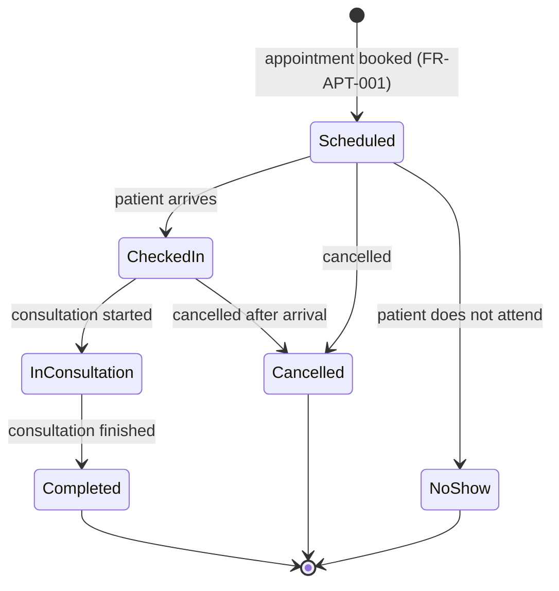

# 19 — Appointment Status Lifecycle

**Source:** BRD: Appointment Management (status values, archiving, slot rules); PDR-07 and PDR-08 (decided 2026-11-10, Project Owner)
**Requirement IDs:** FR-APT-001, FR-APT-002, FR-APT-003, FR-HIS-001 (consultation start)
**Status:** Resolved 2026-11-10. Replaces the earlier reversal rule.

The status model is kept simple on purpose. The Project Owner has said no complex appointment workflow is required for Phase 1.

## 1. Lifecycle (workflow diagram)

Linear path: **Scheduled → Checked-In → In Consultation → Completed**.

Branches: **Scheduled → Cancelled**, **Scheduled → No-show**, **Checked-In → Cancelled**.

## 2. State Transition Table

| From | To | Allowed | Trigger | Notes |
|---|---|---|---|---|
| Scheduled | Checked-In | Yes | Patient arrives | Manual status change |
| Scheduled | Cancelled | Yes | Appointment cancelled | Releases the slot (PDR-07) |
| Scheduled | No-show | Yes | Patient does not attend | Releases the slot (PDR-07) |
| Checked-In | In Consultation | Yes | Consultation started from this appointment | Set by the system when the consultation starts (see §4) |
| Checked-In | Cancelled | Yes | Appointment cancelled after arrival | Releases the slot (PDR-07) |
| In Consultation | Completed | Yes | Consultation finished | Holds the slot until completed |
| Completed | any | No | — | Terminal |
| Cancelled | any | No | — | Terminal |
| No-show | any | No | — | Terminal |
| Any status | earlier status | No | — | No reversal in Phase 1. Confirmed 2026-11-10: the defined transitions are the complete set of allowed moves |
| Scheduled | Completed | No | — | Must pass through Checked-In and In Consultation |
| Scheduled | In Consultation | No | — | Must pass through Checked-In |
| Checked-In | Completed | No | — | Must pass through In Consultation |
| Cancelled | No-show, Scheduled, Checked-In, In Consultation, Completed | No | — | Terminal |
| No-show | Scheduled, Checked-In, In Consultation, Completed, Cancelled | No | — | Terminal |

Six statuses: Scheduled, Checked-In, In Consultation, Completed, Cancelled, No-show.

## 3. Rules

| Rule | Detail | Source |
|---|---|---|
| Slot holding | Scheduled, Checked-In, In Consultation and Completed hold the slot. Cancelled and No-show release it | PDR-07 |
| Overlap | A new appointment may not take a slot held by a non-archived appointment | BRD: Appointments cannot overlap |
| Archiving | Archiving is a separate manual action. It hides the appointment everywhere and does not change its status | PDR-09 |
| No reversal | Status cannot move back to an earlier status | PDR-08 (2026-11-10) |
| Terminal states | Completed, Cancelled and No-show accept no further change | PDR-08 |
| Walk-ins | A walk-in consultation has no appointment, so no status applies | BRD: Consultation Workflow |

## 4. Link to the Consultation

- Starting a consultation from an appointment sets the appointment to In Consultation (the appointment must be Checked-In first).
- Completed follows In Consultation, so an appointment reaches Completed only after its consultation has started.
- **PDR-27 (confirmed 2026-11-10):** an appointment can only reach Completed after In Consultation. It cannot be marked Completed directly from Scheduled or Checked-In. This replaces the earlier answer that Completed needs no consultation.

## 5. Requirement Trace

| Element | Req ID | Test |
|---|---|---|
| Schedule with slot holding | FR-APT-001 | TC-FR-APT-001-1 to -3 |
| Daily list shows status | FR-APT-002 | TC-FR-APT-002-1 |
| Status values and transitions | FR-APT-003 | TC-FR-APT-003-1 (each allowed move), TC-FR-APT-003-2 (each blocked move, including reversal) |
| Consultation start sets In Consultation | FR-HIS-001, FR-APT-003 | TC-FR-APT-003-3 |
| Manual archive hides appointment | FR-APT-003 | TC-FR-APT-003-4 |

## 6. Implementation Notes (for Module 4)

- Store status as a string with a check constraint on the six values.
- Put the transition table in the Business layer (AppointmentService), not in the controller or the database.
- Reject disallowed moves with a Result error that names the current and requested status.
