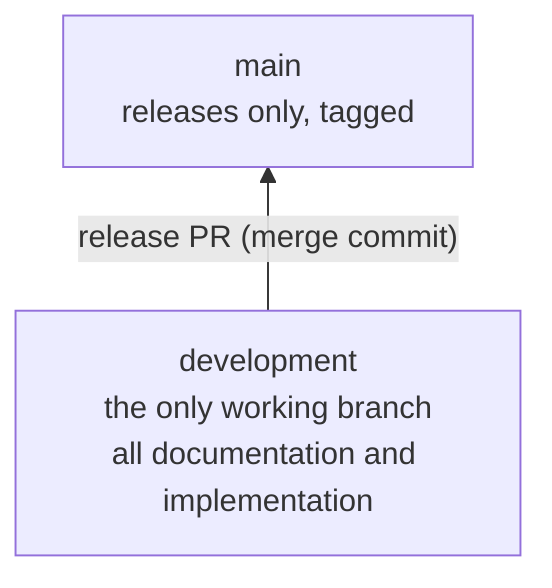

# 01 — Git Strategy

**Module:** 3 — Worktree (training plan)
**Applies to:** Repository `ClaudeCodeBhaskar`, remote `origin` (GitHub)
**Status:** Amended 2026-11-10: `development` is the only working branch (Project Owner instruction)

---

## 1. Branch Model



| Branch | Purpose | Who writes to it | Direct commit | Receives from |
|---|---|---|---|---|
| `development` | The only working branch. Holds all documentation, requirements, planning, governance and implementation | Claude, after the user approves each commit | Yes, after approval (approval gate, CLAUDE.md §5.1) | Commits made here |
| `main` | Released code only. Each release is a tagged merge commit | Release PR only | No | `development` |

No other branches are created. This covers feature, module, milestone, documentation, fix, chore, hotfix and release branches.

## 2. Rules

1. **`development` is the only working branch.** All project work is committed directly to it.
2. **No other working branches.** No feature, module, milestone or documentation branches.
3. **Commits need approval first.** The approval package in CLAUDE.md §5.1 is shown, and the user approves, before each commit or push.
4. **`main` changes only through a release PR** from `development`, with the Project Owner's sign-off (`05-Release-Process.md`).
5. **Nothing is committed to `main` directly.**
6. **No force-push** to `development` or `main`.
7. **No history rewrite on pushed commits.** Mistakes are reverted by new commits (`06-Rollback-Process.md`).
8. **Every change is traceable.** Commit messages list requirement IDs and decision references.

## 3. Flows

### 3.1 Work flow (all project work)

```
primary checkout on development (up to date with origin)
  → make the change
  → run checks (build and tests for implementation)
  → approval package in chat (CLAUDE.md §5.1)
  → user approves
  → commit on development (03-Commit-Standards.md)
  → push development to origin
```

### 3.2 Release flow

```
development (all work for the release committed, checks passed, matrix checked)
  → release PR development → main (merge commit)
  → review and Project Owner sign-off
  → merge; tag vX.Y.Z on main
```

See `05-Release-Process.md`.

### 3.3 Urgent fix flow

There is no hotfix branch. An urgent fix is committed to `development` through the approval gate, then released through the release flow in §3.2. If a released build must be fixed before the next release, the fix goes to `development` and a patch release follows the same steps (decision D-10).

## 4. Current State (observed 2026-11-10)

| Item | State |
|---|---|
| `development` | Local and `origin/development` at the same commit after the documentation push (`a875aac`) |
| `main` | `115126c`. Not yet updated by a release |
| Working branches | `development` only |
| Worktrees | Primary checkout on `development` |
| Tags | None |
| Untracked | `Reference/` (binary `.docx`; decision D-4) |

## 5. Gaps and Actions

| Gap | Action | Owner |
|---|---|---|
| `main` has no release yet | First release when Module 4 is complete (D-7) | Project Owner approval |
| No branch protection | Protect `main` (PR required, no force-push). Protect `development` (no force-push, no deletion) (D-6) | Project Owner (repository admin) |
| `Reference/` untracked | Decide whether to track the binary `.docx` (D-4) | Project Owner |
| Worktree isolation for development | Use detached worktrees for verification (`07-Worktree-Standards.md`) (D-9) | Project Owner approval |

## 6. Decisions

See `00-Worktree-Review-Package.md` §3.
