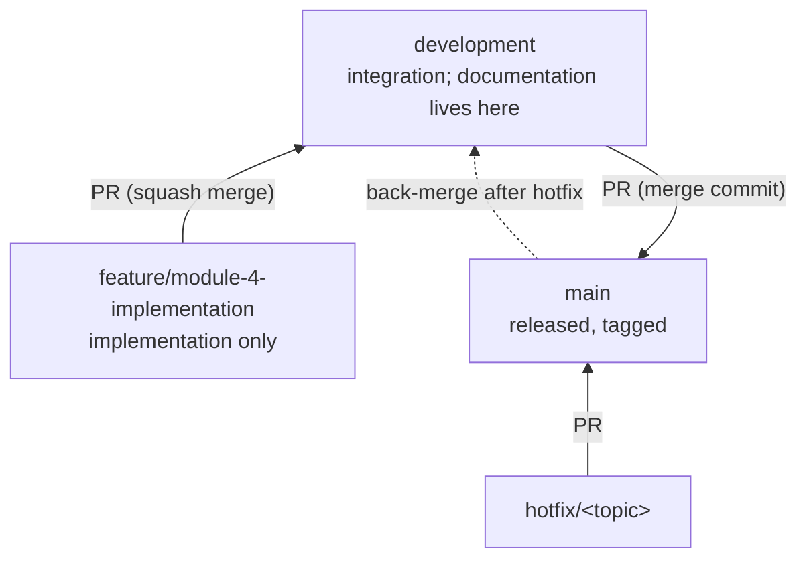

# 01 — Git Strategy

**Module:** 3 — Worktree (training plan)
**Applies to:** Repository `ClaudeCodeBhaskar`, remote `origin` (GitHub)
**Status:** Proposed for review. No Git operation has been performed for this artifact set.

---

## 1. Branch Model



| Branch | Purpose | Who writes to it | Direct push | Receives from |
|---|---|---|---|---|
| `main` | Released code only. Every commit is a release or hotfix | Pull requests only | Not allowed | `development` (release PR), `hotfix/*` |
| `development` | Integration branch. Holds all approved documentation and merged implementation | Pull requests; approved documentation commits (see §3.1) | Documentation commits only, after approval (see decision D-1) | `feature/module-4-implementation`, `docs/*` if used, back-merges |
| `feature/module-4-implementation` | Module 4 implementation (the approved plan) | Claude, inside its worktree, after approval | Yes, by the approved commit flow | Cut from `development` |

## 2. Rules

1. **Documentation work stays on `development`.** Requirements, planning, workflow and governance files are not put on feature branches.
2. **Only implementation uses a feature branch.** Application code, tests and migrations go on `feature/module-4-implementation`.
3. **Pull request from `feature/module-4-implementation` to `development`.** One PR for the Module 4 delivery.
4. **Pull request from `development` to `main`.** Only at a release point (see `05-Release-Process.md`).
5. **Nothing is committed to `main` directly.** Hotfixes go through `hotfix/*` and a PR.
6. **Nothing is pushed or merged without the approval gate** (CLAUDE.md §5.1 and `03-Commit-Standards.md` §5).
7. **No force-push** to `main`, `development` or any branch that others use.
8. **Every change is traceable** to requirement IDs in its commit messages and PR description.

## 3. Flows

### 3.1 Documentation flow

```
edit files in the primary checkout (on development)
  → approval package in chat (CLAUDE.md §5.1)
  → user approves
  → commit on development (docs-only commit, Requirements footer when relevant)
  → push development to origin
```

No feature branch and no PR for documentation. Decision D-1 asks whether a documentation PR should be used instead.

### 3.2 Implementation flow (Module 4)

```
development (up to date)
  → create worktree and branch feature/module-4-implementation from development
  → plan confirmed (Module 2 approved) → implement in the worktree
  → each work package: tests run, commit (approval gate first)
  → push feature branch
  → PR feature/module-4-implementation → development (squash merge)
  → review (see 04-Review-Process.md)
  → merge; delete remote and local feature branch; remove worktree
```

### 3.3 Release flow

```
development (all Module 4 merged, tests pass, matrix checked)
  → PR development → main (merge commit)
  → review and Project Owner sign-off
  → merge; tag vX.Y.Z on main
  → back-check that development equals main (no differences)
```

See `05-Release-Process.md`.

### 3.4 Hotfix flow

```
main
  → hotfix/<topic> from main
  → fix, test, PR hotfix/<topic> → main
  → merge; tag patch version on main
  → back-merge main into development (PR or approved commit)
```

See `06-Rollback-Process.md` §4.

## 4. Current State (observed 2026-11-10)

| Item | State |
|---|---|
| `main` | `115126c` (Delete README.md). Equal to `origin/main` |
| `development` | Exists on `origin` at `115126c`. No local branch yet |
| `feature/module-4-implementation` | Does not exist |
| Worktrees | One: the primary checkout on `main` |
| Tags | None |
| Working tree | `BRD/`, `Documentation/`, `Reference/` and `CLAUDE.md` are untracked |

`BRD/` was removed from the repository in commit `0b2e86f`. Committing it restores the directory. `Reference/` contains a binary `.docx`.

## 5. Gaps Between the Approved Model and the Current Repository

| Gap | Action | Owner |
|---|---|---|
| No local `development` branch | Create it from `origin/development` when the first documentation commit is approved | Claude, after approval |
| Documentation untracked on `main` | Move to `development` as one approved commit (D-4) | Project Owner approval |
| Primary checkout on `main` | Switch the primary checkout to `development` for documentation work (D-5) | Claude, after approval |
| No branch protection rules | Enable on GitHub for `main` and `development` (D-6) | Project Owner (repository admin) |
| CLAUDE.md §5 says never commit to `development` directly | Amend for documentation-only commits (D-1) | Project Owner approval |
| CLAUDE.md §5 says one feature per branch | Amend for the single Module 4 branch (D-2) | Project Owner approval |

## 6. Decisions Requested

See `00-Worktree-Review-Package.md` §3 for the full list (D-1 to D-8).
